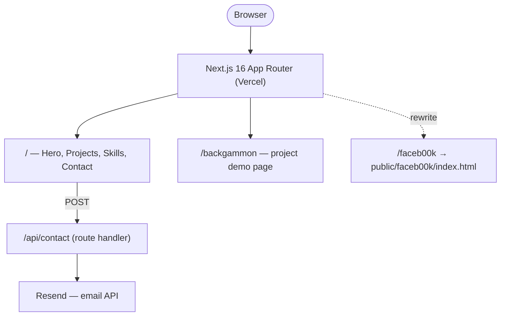

# 🧪 yarin-lab

[](package.json)
[](package.json)
[](tsconfig.json)
[](postcss.config.mjs)
[](vitest.config.ts)
[](https://yarin-lab.vercel.app)

The personal portfolio site of Yarin Solomon, a full-stack developer specialising in API
development, microservices, and AI-integrated systems.

The site is a single Next.js App Router page composed from four sections — Hero, Projects,
Skills, Contact — plus two standalone routes: a Backgammon AI project demo and a `/faceb00k`
security-assignment showcase served as a static rewrite. The one piece with real server logic is
the contact form: it posts to a Next.js API route that sends mail through Resend, so the API key
never reaches the browser.

**Live:** [yarin-lab.vercel.app](https://yarin-lab.vercel.app)

## 📑 Table of Contents

- [🏗️ Architecture](#-architecture)
- [💻 Local Development](#-local-development)
- [🔑 Environment Variables](#-environment-variables)
- [🔌 API](#-api)
- [🧪 Testing](#-testing)
- [📁 Repo Layout](#-repo-layout)
- [👤 Author](#-author)

## 🏗️ Architecture



- **App Router page** (`src/app/page.tsx`) composes the four sections; each section owns its own
  markup and is self-contained.
- **`/backgammon`** (`src/app/backgammon/page.tsx`) is a project page offering the Backgammon AI
  desktop build (`public/backgammon/BackgammonAI.exe`, `.zip`) for download, with a demo GIF.
- **`/faceb00k`** is not a Next.js route — `next.config.ts` rewrites it straight to a static HTML
  file in `public/faceb00k/`, a BGU security-course assignment kept as-is.
- **Contact API** (`src/app/api/contact/route.ts`) validates the request body, then calls Resend
  server-side. It returns `500` if `RESEND_API_KEY` is unset, so a misconfigured deploy fails
  loudly instead of silently dropping messages.

## 💻 Local Development

**Prerequisites:** Node.js (Next.js 16 / React 19), no external services required to boot — the
contact form degrades to a `500` without a Resend key.

1. Install dependencies:

   ```bash
   npm install
   ```

2. Create a `.env.local` file in the project root:

   ```
   RESEND_API_KEY=<your resend.com api key>
   ```

   Optional: `CONTACT_TO_EMAIL` (defaults to `yarinso39@gmail.com`).

3. Start the dev server:

   ```bash
   npm run dev
   ```

4. Open [http://localhost:3000](http://localhost:3000).

**Tests:** `npm test`

## 🔑 Environment Variables

| Variable | Required | Default | Purpose |
|---|---|---|---|
| `RESEND_API_KEY` | Yes (production) | — | Authenticates with the Resend email API. The contact route returns `500` without it. |
| `CONTACT_TO_EMAIL` | No | `yarinso39@gmail.com` | Overrides the recipient for contact form emails. |

Never commit `.env` or `.env.local`.

## 🔌 API

| Method | Path | Body | Returns |
|---|---|---|---|
| `POST` | `/api/contact` | `{ name, email, message }` | `200 { success: true }` on send; `400` on invalid/missing fields; `500` if `RESEND_API_KEY` is unset; `503` if the Resend call fails |

## 🧪 Testing

```bash
npm test            # Vitest, single run
npm run test:watch  # Vitest, watch mode
```

Tests live in `src/__tests__/` and mirror the `src/` directory structure. The Resend SDK is
mocked at the module level in the contact tests — no real network calls are made.

## 📁 Repo Layout

```
src/
  app/
    api/contact/        # POST /api/contact — sends email via Resend
    backgammon/          # Backgammon AI project demo page
    layout.tsx           # Root layout (Navbar, Analytics, fonts)
    page.tsx              # Home page — composes Hero, Projects, Skills, Contact
  components/
    layout/               # Navbar
    sections/             # Hero, Projects, Skills, Contact
    ui/                    # Badge, ProjectCard, ProjectCarousel, ProjectPreview, ContactForm, GlowBackdrop
  hooks/                  # useAnimatedLabel, usePrefersReducedMotion
  __tests__/              # Vitest tests (mirrors src/)
public/
  backgammon/             # BackgammonAI.exe, .zip, and demo GIF
  faceb00k/               # Static HTML/CSS/JS served via the /faceb00k rewrite
  cv.pdf
```

## 👤 Author

**Yarin Solomon** — Full Stack Developer

- Email: [yarinso39@gmail.com](mailto:yarinso39@gmail.com)
- GitHub: [github.com/yarins0](https://github.com/yarins0)
- LinkedIn: [linkedin.com/in/yarin-solomon](https://www.linkedin.com/in/yarin-solomon/)
- Portfolio: [yarin-lab](https://yarin-lab.vercel.app/)
